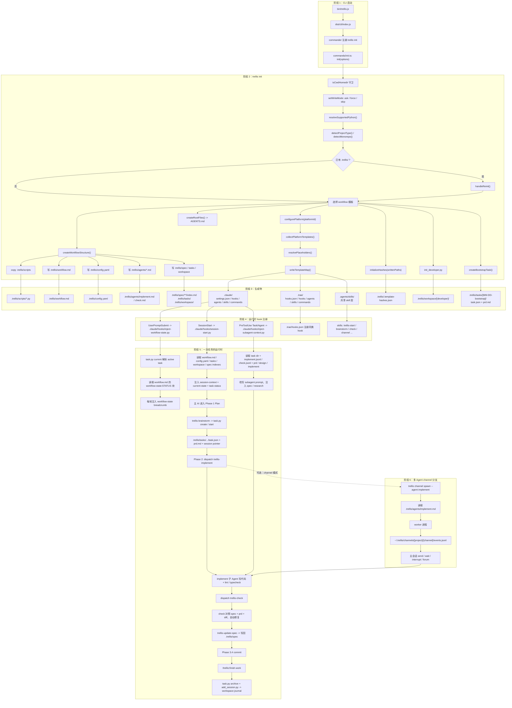
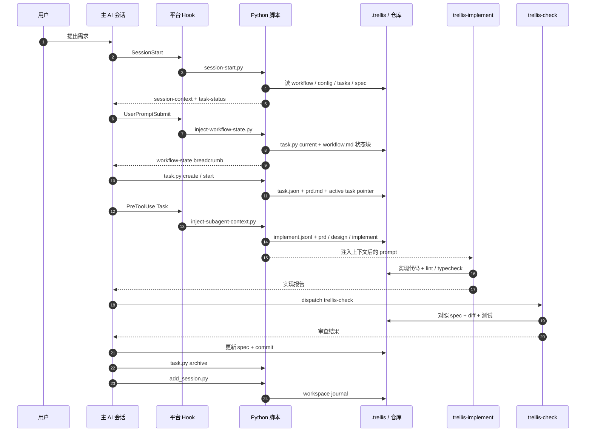
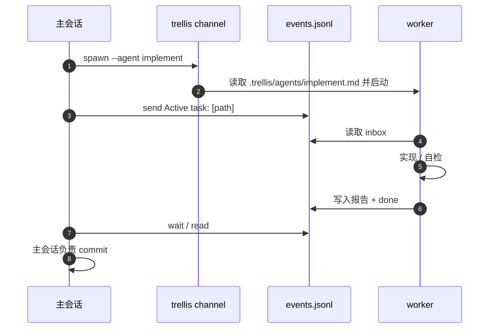

flowchart TD

  subgraph S1["阶段 1：CLI 启动"]
    A1["bin/trellis.js"] --> A2["dist/cli/index.js"]
    A2 --> A3["commander 注册 trellis init"]
    A3 --> A4["commands/init.ts: init(options)"]
  end

  subgraph S2["阶段 2：trellis init"]
    A4 --> B1["isCwdHomedir 守卫"]
    B1 --> B2["setWriteMode: ask / force / skip"]
    B2 --> B3["resolveSupportedPython()"]
    B3 --> B4["detectProjectType() / detectMonorepo()"]
    B4 --> B5{"已有 .trellis/ ?"}
    B5 -->|是| B6["handleReinit()"]
    B5 -->|否| B7["选择 workflow 模板"]
    B6 --> B7

    B7 --> B8["createWorkflowStructure()"]
    B8 --> B9["copy .trellis/scripts"]
    B8 --> B10["写 .trellis/workflow.md"]
    B8 --> B11["写 .trellis/config.yaml"]
    B8 --> B12["写 .trellis/agents/*.md"]
    B8 --> B13["写 .trellis/spec / tasks / workspace"]

    B7 --> B14["configurePlatform(platformId)"]
    B14 --> B15["collectPlatformTemplates()"]
    B15 --> B16["resolvePlaceholders()"]
    B16 --> B17["writeTemplateMap()"]

    B7 --> B18["createRootFiles() -> AGENTS.md"]
    B7 --> B19["initializeHashes(writtenPaths)"]
    B7 --> B20["init_developer.py"]
    B7 --> B21["createBootstrapTask()"]
  end

  subgraph S3["阶段 3：生成物"]
    B9 --> C1[".trellis/scripts/*.py"]
    B10 --> C2[".trellis/workflow.md"]
    B11 --> C3[".trellis/config.yaml"]
    B12 --> C4[".trellis/agents/implement.md / check.md"]
    B13 --> C5[".trellis/spec/**/index.md .trellis/tasks/ .trellis/workspace/"]
    B17 --> C6[".claude/ settings.json / hooks / agents / skills / commands"]
    B17 --> C7[".trae/ hooks.json / hooks / agents / skills / commands"]
    B17 --> C8[".agents/skills/ 共享 skill 层"]
    B19 --> C9[".trellis/.template-hashes.json"]
    B20 --> C10[".trellis/workspace/[developer]/"]
    B21 --> C11[".trellis/tasks/[MM-DD-bootstrap]/ task.json + prd.md"]
  end

  subgraph S4["阶段 4：运行时 hook 注册"]
    C6 --> D1["SessionStart -> .claude/hooks/session-start.py"]
    C6 --> D2["UserPromptSubmit -> .claude/hooks/inject-workflow-state.py"]
    C6 --> D3["PreToolUse Task/Agent -> .claude/hooks/inject-subagent-context.py"]
    C7 --> D4[".trae/hooks.json 注册同类 hook"]
    C8 --> D5["skills: trellis-start / brainstorm / check / channel ..."]
  end

  subgraph S5["阶段 5：一次任务的运行时"]
    D1 --> E1["读取 workflow.md / config.yaml / tasks / workspace / spec indexes"]
    E1 --> E2["注入 session-context + current-state + task-status"]
    D2 --> E3["task.py current 解析 active task"]
    E3 --> E4["读取 workflow.md 的 workflow-state:STATUS 块"]
    E4 --> E5["每轮注入 workflow-state breadcrumb"]
    D3 --> E6["读取 task dir + implement.jsonl / check.jsonl + prd / design / implement"]
    E6 --> E7["改写 subagent prompt，注入 spec / research"]

    E2 --> F1["主 AI 进入 Phase 1 Plan"]
    F1 --> F2["trellis-brainstorm -> task.py create / start"]
    F2 --> F3[".trellis/tasks/.../task.json + prd.md + session pointer"]
    F3 --> F4["Phase 2: dispatch trellis-implement"]
    F4 --> F5["implement 子 Agent 写代码 + lint / typecheck"]
    E7 --> F5
    F5 --> F6["dispatch trellis-check"]
    F6 --> F7["check 对照 spec + prd + diff，自动修复"]
    F7 --> F8["trellis-update-spec -> 写回 .trellis/spec"]
    F8 --> F9["Phase 3.4 commit"]
    F9 --> F10["/trellis:finish-work"]
    F10 --> F11["task.py archive + add_session.py -> workspace journal"]
  end

  subgraph S6["阶段 6：多 Agent channel 分支"]
    F4 -.->|可选：channel 模式| G1["trellis channel spawn --agent implement"]
    G1 --> G2["读取 .trellis/agents/implement.md"]
    G2 --> G3["worker 进程"]
    G3 --> G4["~/.trellis/channels/[project]/[channel]/events.jsonl"]
    G4 --> G5["主会话 send / wait / interrupt / forum"]
    G5 --> F5
  end# Trellis：从 `trellis init` 到运行时 hook 的完整调用图

> 基于 `f:\xiangfa\Trellis` 源码（v0.6.17）整理。  
> 图中 Claude Code 的 `.claude/` 只是示例；同一套 Python hook 脚本会被复制到 Trae、Cursor、Codex 等平台的对应目录，并由各平台的 settings / hooks.json 注册。

## 图 1：总调用图

## 图 2：一次任务的运行时序

## 图 3：channel 多 Agent 分支

## 关键文件索引

| 阶段 | 文件 |
|---|---|
| CLI 入口 | `packages/cli/bin/trellis.js`、`packages/cli/src/cli/index.ts` |
| init 主流程 | `packages/cli/src/commands/init.ts` |
| `.trellis/` 结构 | `packages/cli/src/configurators/workflow.ts` |
| 平台模板收集 | `packages/cli/src/configurators/` 下各平台文件、`configurators/shared.ts` |
| 模板发现 | `packages/cli/src/templates/common/index.ts` |
| 模板哈希 | `packages/cli/src/utils/template-hash.ts`、`.trellis/.template-hashes.json` |
| 任务/会话脚本 | `.trellis/scripts/task.py`、`get_context.py`、`add_session.py`、`common/*` |
| 运行时 hooks | `.claude/hooks/session-start.py`、`inject-workflow-state.py`、`inject-subagent-context.py` |
| 流程唯一事实源 | `.trellis/workflow.md` |
| 平台子 Agent | `.claude/agents/trellis-implement.md`、`trellis-check.md`、`trellis-research.md` |
| Channel 角色卡 | `.trellis/agents/implement.md`、`check.md`、`architect.md`、`plan.md`、`research.md` |
| Channel 运行时 | `packages/core/src/channel/`、`packages/cli/src/commands/channel/` |

## 读图要点

1. **init 只负责“铺文件”**：`.trellis/` 提供流程、任务、规范、脚本；平台目录提供 skill、command、agent、hook 注册。
2. **workflow.md 是流程唯一事实源**：每轮提示不是硬编码在 hook 里，而是 hook 解析 `[workflow-state:STATUS]` 块得到的。
3. **SessionStart 管“开局”**：注入项目状态、workflow 摘要、spec 索引、当前任务状态。
4. **UserPromptSubmit 管“当前阶段”**：解析 active task 的 `task.json.status`，给出 `no_task / planning / in_progress` 等面包屑。
5. **PreToolUse 管“子 Agent 上下文”**：按 `implement.jsonl` / `check.jsonl` 把 spec、research、prd、design、implement 注入子 Agent prompt。
6. **子 Agent 不提交**：`trellis-implement` / `trellis-check` 被禁止 `git commit` / `git push` / `git merge`，提交由主会话在 Phase 3.4 统一做。
7. **channel 是重型分支**：需要多轮对话、可中断 worker、持久事件日志时才用；普通任务直接走平台子 Agent。
